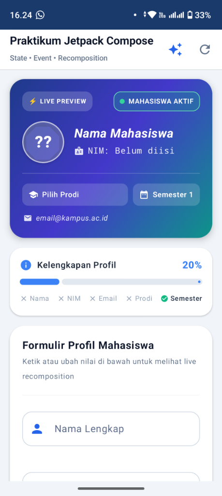
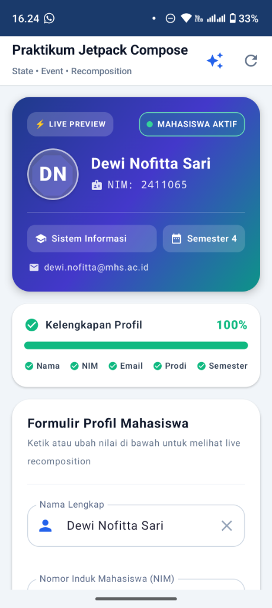

# 📱 Praktikum Jetpack Compose: Profil Mahasiswa
**Eksplorasi State, Event, dan Recomposition di Android Modern**

Proyek ini dibangun menggunakan **Kotlin** dan **Jetpack Compose (Material 3)** untuk mendemonstrasikan implementasi arsitektur *Unidirectional Data Flow* (UDF), manajemen *State*, penanganan *Event*, dan mekanisme *Recomposition* otomatis secara real-time.

---

## 👤 Identitas Mahasiswa
* **Nama Lengkap**: Dewi Nofitta Sari
* **NIM**: 2411065
* **Program Studi**: Sistem Informasi
* **Mata Kuliah**: Pemrograman Perangkat Bergerak / Mobile Application Development

---

## 📸 Tangkapan Layar Aplikasi (Screenshots)

| Kondisi Form Kosong (State Awal 20%) | Kondisi Form Terisi Lengkap (State Selesai 100%) |
| :---: | :---: |
|  |  |
| *Avatar "?", Nama default, NIM belum diisi, kelengkapan 20%, tombol simpan non-aktif.* | *Avatar dinamis "DN", Nama & NIM terisi, chip prodi terpilih, kelengkapan 100%, siap disimpan.* |

---

## 📝 Refleksi Singkat (Learning Reflection)

Praktikum ini memberikan pemahaman mendalam tentang pergeseran paradigma dari pemrograman Android imperatif (berbasis XML dan `findViewById`) menuju paradigma **deklaratif** pada **Jetpack Compose**:

1. **Pemisahan State dan UI (State Hoisting & Single Source of Truth)**:
   Seluruh status form tidak lagi disimpan di dalam widget UI, melainkan dipusatkan di dalam `ProfilViewModel` menggunakan `mutableStateOf`. Pendekatan ini membuat UI menjadi murni fungsi dari state (*UI = f(State)*), menghilangkan kemungkinan inkonsistensi data antara input form dan kartu pratinjau.

2. **Aliran Data Searah (Unidirectional Data Flow - UDF)**:
   Interaksi pengguna (seperti mengetik nama, memasukkan angka NIM, memilih chip prodi, menggeser slider semester, dan menyalakan switch) diperlakukan sebagai **Event** yang dikirimkan ke atas menuju ViewModel. ViewModel memvalidasi dan memperbarui **State**, yang kemudian dialirkan kembali ke bawah menuju komponen Composable.

3. **Efisiensi Mekanisme Recomposition**:
   Mekanisme *intelligent recomposition* pada Compose terbukti sangat efisien. Setiap kali satu karakter diketik atau saklar status disentuh, Compose hanya mengeksekusi ulang fungsi composable yang secara langsung membaca state tersebut (seperti `LivePreviewCard` dan `CompletionProgressBar`), sementara form input lainnya tidak perlu dirender ulang dari awal. Transisi warna gradasi kartu menggunakan `animateColorAsState` dan progress bar `animateFloatAsState` juga berjalan sangat mulus pada 60fps tanpa lagging.

---

## 🌟 Fitur Utama Aplikasi

1. **⚡ Header Gradasi sebagai Pratinjau Langsung (Live Preview)**:
   - Terletak di atas formulir dengan desain modern rounded card (`RoundedCornerShape(24.dp)`).
   - Inisial avatar terhitung otomatis secara cerdas (*"Dewi Nofitta Sari"* $\rightarrow$ **"DN"**).
   - Warna gradasi kartu bertransisi halus (*animated gradient*) saat status aktif/cuti diubah:
     - **Mahasiswa Aktif**: Gradasi cerah (*Royal Blue $\rightarrow$ Indigo $\rightarrow$ Teal*).
     - **Non-Aktif / Cuti**: Gradasi tenang (*Dark Slate Gray*).
2. **📋 Formulir Input & Validasi**:
   - **Nama Lengkap**: Validasi minimal 3 karakter dengan pesan error real-time.
   - **NIM**: Difilter ketat di level event sehingga hanya menerima karakter digit angka (contoh: **2411065**).
   - **Email**: Validasi format email berbasis Regex standar (memeriksa keberadaan `@` dan nama domain).
   - **Pilihan Program Studi (FilterChip)**: Komponen chip interaktif dengan indikator centang terpilih.
   - **Semester (Slider)**: Slider diskrit 1–8 dengan indikator teks "Semester X".
   - **Status Mahasiswa (Switch)**: Toggle saklar untuk mahasiswa aktif vs cuti.
3. **📊 Bilah Kelengkapan Profil (0–100%) Beranimasi**:
   - Menggunakan `LinearProgressIndicator` dengan animasi spring physics.
   - Dilengkapi checklist indikator mini (Nama, NIM, Email, Prodi, Semester).
4. **💾 Tombol Simpan & Banner Sukses**:
   - Tombol Simpan hanya aktif (*enabled*) ketika persentase kelengkapan mencapai 100%.
   - Menampilkan banner hijau beranimasi (`AnimatedVisibility` dengan fade-in & expand) yang merangkum data mahasiswa yang tersimpan.
   - Tombol pintas cepat: *"Isi Data Otomatis: Dewi Nofitta Sari (2411065)"* untuk kemudahan pengujian.

---

## 🛠️ Struktur Berkas Proyek

```text
ProfilMahasiswa/
├── app/
│   ├── src/
│   │   ├── main/
│   │   │   └── java/com/example/profilmahasiswa/
│   │   │       ├── MainActivity.kt        # Entry point activity
│   │   │       ├── ProfilMahasiswaApp.kt  # Seluruh Composable UI & Layout
│   │   │       └── ProfilViewModel.kt     # Pengelola State, Event & Validasi
│   │   └── test/
│   │       └── java/com/example/profilmahasiswa/
│   │           └── ProfilViewModelTest.kt # Unit Test logika State & Event (Passed)
│   └── build.gradle.kts
├── screenshots/
│   ├── screenshot_form_kosong.png         # Tangkapan layar form kosong
│   └── screenshot_form_terisi.png         # Tangkapan layar form terisi lengkap
└── README.md
```

---

## 🚀 Cara Menjalankan Aplikasi

1. Buka folder ini di **Android Studio** (**File > Open**).
2. Biarkan Gradle melakukan sinkronisasi otomatis.
3. Jalankan aplikasi di emulator atau perangkat fisik Android dengan menekan **Run (Shift + F10)**.
